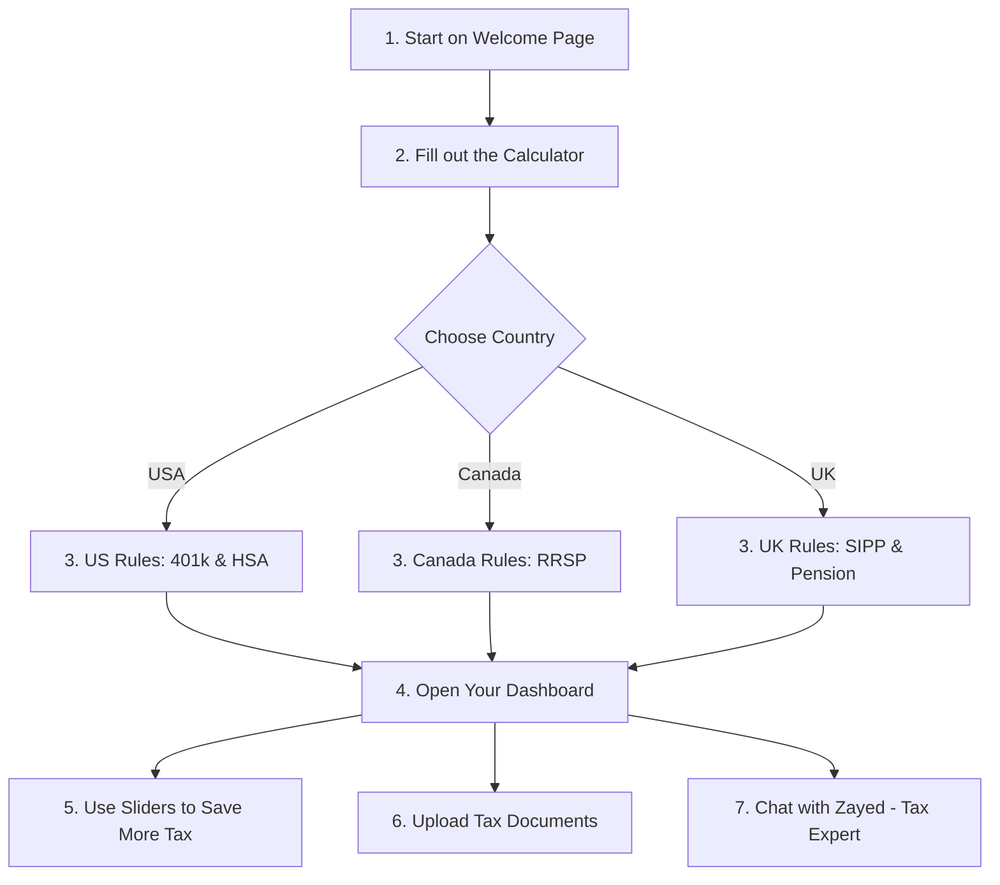

# 📊 Tax Saver Agent

Tax Saver Agent is a simple website that helps you find ways to save money on your taxes. It supports the **United States, Canada, and the United Kingdom**. 

You can find out how much tax you owe, adjust sliders to see how saving for retirement lowers your tax bill, upload tax forms, and chat with an expert.

---

## 🗺️ How the App Works (Flow Chart)

Here is a simple chart showing the steps of the website:



---

## 💡 Simple Steps to Use the App

1.  **Welcome Screen**: Click the **"Begin Personalized Analysis"** button to start.
2.  **Fill out the Calculator (Wizard)**:
    *   **Step 1**: Pick your country (US, Canada, or UK) and state/province.
    *   **Step 2**: Enter your filing status (Single or Married) and number of kids.
    *   **Step 3**: Enter your gross annual income.
    *   **Step 4**: Enter what you currently save for retirement or medical expenses.
    *   Click **"Calculate Savings"**.
3.  **View Your Dashboard**: The page will load and unlock your personal tax summary.
4.  **Use the Sliders (Playground)**: Drag the sliders to see how contributing more money to your retirement accounts reduces your tax bill immediately.
5.  **Check the Investments List**: See a list of your retirement plans and check their status (Active, Completed, or Eligible).
6.  **Upload Documents**: Go to the **Documents** tab to upload and manage files like W-2s, T4 slips, or receipts.
7.  **Ask for Help**: Go to the **Expert Support** tab to text Zayed Ansari (our simulated tax expert) and receive real-time answers.

---

## 🛠️ Files in This Project

*   `index.html`: The main web page code and layouts.
*   `style.css`: The colors, styling, and design.
*   `app.js`: The tax calculation engine and dynamic slider math.
*   `README.md`: This guide.

---

## 💻 How to Open the Website

### Option 1: Direct File Open (easiest)
*   Find the [index.html](file:///Users/condenast/5%20day%20ai/index.html) file on your computer and double-click it. It will open in your web browser.

### Option 2: Run a Local Server (Recommended)
1. Open your computer's terminal program.
2. Run this command:
   ```bash
   python3 -m http.server 8000
   ```
3. Open your browser and go to: [http://localhost:8000/index.html](http://localhost:8000/index.html)
